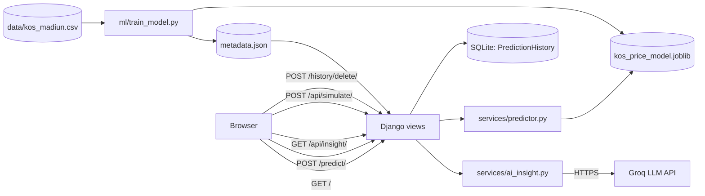

<div align="center">

# GusSearch Kost

**Prediksi Kost by Ai — perkiraan harga sewa kost di Kota Madiun.**

Aplikasi web Django yang memperkirakan harga sewa bulanan dengan machine learning, lalu memberikan penjelasan sederhana dengan bantuan AI (Groq).


</div>

---

## Daftar Isi

- [Gambaran Umum](#gambaran-umum)
- [Fitur](#fitur)
- [Arsitektur](#arsitektur)
- [Teknologi](#teknologi)
- [Struktur Projek](#struktur-projek)
- [Memulai](#memulai)
- [Konfigurasi](#konfigurasi)
- [Cara Penggunaan](#cara-penggunaan)
- [Pipeline Machine Learning](#pipeline-machine-learning)
- [Referensi API](#referensi-api)
- [Performa Model & Keterbatasan](#performa-model--keterbatasan)
- [Pengujian](#pengujian)
- [Catatan Keamanan](#catatan-keamanan)
- [Roadmap](#roadmap)
- [Kontribusi](#kontribusi)
- [Lisensi](#lisensi)

## Gambaran Umum

Calon penyewa sering tidak tahu apakah harga kost yang ditawarkan wajar. **GusSearch Kost** adalah aplikasi Django untuk menjelajahi data kos di Kota Madiun, memperkirakan harga sewa bulanan, dan membandingkan hasilnya dengan data pasar.

Prediksi menggunakan tiga masukan:

| Masukan | Keterangan |
|---|---|
| Jarak | Jarak ke pusat kota (km) |
| AC | Apakah kamar ber-AC (`ya` / `tidak`) |
| Rating | Nilai ulasan penghuni (0–5) |

Model machine learning menghasilkan perkiraan harga dan kisaran indikatif. Pengguna juga dapat mencari kos berdasarkan batas budget dari dataset yang tersedia. Jika `GROQ_API_KEY` dikonfigurasi, [Groq](https://groq.com) dapat memberikan penjelasan singkat untuk ringkasan pasar, hasil prediksi, grafik, dan metrik model. Penjelasan AI dapat keliru, jadi periksa kembali data aslinya.

<!-- Tambahkan tangkapan layar ke docs/screenshots/ lalu aktifkan:

-->

## Fitur

- **Prediksi harga**: perkiraan sewa bulanan, kisaran wajar, dan perbandingan dengan rata-rata pasar.
- **Cari kos sesuai budget**: filter daftar kos berdasarkan budget Rp100.000–Rp10.000.000 per bulan.
- **Dasbor pasar**: statistik utama (jumlah, rata-rata, median, termurah, termahal, rating rata-rata).
- **Grafik interaktif**: harga AC vs non-AC, harga vs jarak, dan harga vs rating (nama kos tampil saat kursor diarahkan).
- **Simulasi prediksi**: ubah jarak, AC, atau rating untuk membandingkan perkiraan dengan hasil prediksi terakhir.
- **Penjelasan AI opsional**: insight per bagian dengan cache server 30 menit dan tombol *Jelaskan ulang*; memerlukan API key Groq.
- **Riwayat prediksi**: prediksi disimpan di SQLite; dasbor menampilkan 15 terbaru dan menyediakan aksi untuk menghapus seluruh riwayat.
- **Kartu model yang transparan**: MAE, R², dan jumlah data latih/uji ditampilkan beserta kamus istilah.
- **Responsif**: nyaman di desktop maupun ponsel, menghormati pengaturan *reduced motion*.

## Arsitektur



## Teknologi

| Lapisan | Teknologi |
|---|---|
| Backend | Django (Python) |
| Machine learning | scikit-learn, joblib |
| Penjelasan LLM | Groq API |
| Database | SQLite |
| Frontend | Template Django, Tailwind CSS (CDN), Chart.js, CSS/JavaScript aplikasi |

## Struktur Projek

```
KOS-PREDICT-AI/
├── manage.py                    # Titik masuk Django
├── .env.example                 # Contoh variabel lingkungan
├── .env                         # Konfigurasi lokal setelah disalin (jangan di-commit)
├── db.sqlite3                   # Database lokal setelah migrasi (jangan di-commit)
│
├── config/                      # Konfigurasi utama Django
│   ├── settings.py
│   └── urls.py
│
├── data/
│   └── kos_madiun.csv           # Dataset: nama, jarak, harga, AC, rating
│
├── ml/
│   └── train_model.py           # Melatih & membandingkan model kandidat
├── ml_models/
│   ├── kos_price_model.joblib   # Model hasil training (dipakai prediksi)
│   └── metadata.json            # Metrik evaluasi (MAE, R², ukuran split)
│
└── prediction/                  # Aplikasi utama
    ├── models.py                # PredictionHistory (riwayat prediksi)
    ├── views.py                 # Dasbor, prediksi, rekomendasi, API, riwayat
    ├── urls.py                  # Rute halaman dan fitur prediction
    ├── services/
    │   ├── predictor.py         # Memuat model, prediksi, dan pencarian kos serupa
    │   └── ai_insight.py        # Klien Groq opsional untuk penjelasan AI
    ├── templates/prediction/
    │   ├── dashboard.html       # Dasbor (6 tab) dan interaksi frontend
    │   └── _ai_card.html        # Komponen kartu penjelasan berbantuan AI
    └── static/prediction/
        ├── css/kosguss-theme.css
        └── js/kosguss-fx.js
```

## Memulai

### Prasyarat

- Python 3.10 atau lebih baru
- [API key Groq](https://console.groq.com/keys) (opsional; hanya untuk penjelasan AI)

### Instalasi

```bash
# 1. Clone repositori lalu masuk ke foldernya
git clone https://github.com/BagusDananjaya1922/KOS-PREDICT-AI.git
cd KOS-PREDICT-AI

# 2. Buat dan aktifkan virtual environment
python -m venv .venv
source .venv/bin/activate            # Windows: .venv\Scripts\activate

# 3. Pasang dependensi
pip install -r requirements.txt

# 4. Salin konfigurasi lokal dan isi SECRET_KEY
cp .env.example .env                 # SECRET_KEY wajib; GROQ_API_KEY opsional

# 5. Jalankan migrasi database
python manage.py migrate

# 6. Nyalakan server pengembangan
python manage.py runserver
```

Buka **http://127.0.0.1:8000** di browser. Matikan server dengan `Ctrl + C`.

## Konfigurasi

Salin `.env.example` menjadi `.env` di root projek. `SECRET_KEY` wajib diisi agar Django dapat dimulai. `GROQ_API_KEY` hanya diperlukan untuk fitur penjelasan AI; prediksi dan pencarian budget dapat digunakan tanpa API key tersebut.

```env
SECRET_KEY=ganti-dengan-secret-key-acak
GROQ_API_KEY=
GROQ_MODEL=openai/gpt-oss-120b
```

| Variabel | Wajib | Keterangan |
|---|---|---|
| `SECRET_KEY` | Ya | Secret Django; jangan gunakan nilai contoh pada deployment |
| `GROQ_API_KEY` | Tidak | API key Groq; wajib hanya jika ingin menggunakan penjelasan AI |
| `GROQ_MODEL` | Tidak | Nama model Groq; default `openai/gpt-oss-120b` |

File `.env` dibaca oleh `config/settings.py` dan diabaikan Git. Restart server setelah mengubahnya.

## Cara Penggunaan

Antarmuka terdiri dari enam tab:

| Tab | Isi |
|---|---|
| **Beranda** | Ringkasan pasar Madiun dan ringkasan dari AI |
| **Cek Harga Kos** | Form prediksi, perkiraan sewa, kisaran wajar, penjelasan AI |
| **Cari Kos** | Rekomendasi data kos yang harganya tidak melebihi budget |
| **Grafik Pasar** | Tiga grafik, masing-masing dijelaskan AI |
| **Riwayat** | Maksimal 15 prediksi terbaru dan aksi hapus seluruh riwayat |
| **Tentang Model** | Akurasi model dengan bahasa sederhana + kamus istilah |

## Pipeline Machine Learning

Latih ulang dan evaluasi model setelah dataset diperbarui:

```bash
python ml/train_model.py
```

Skrip membaca `data/kos_madiun.csv` (30 entri saat ini; kolom harga diasumsikan dalam ribuan Rupiah), membandingkan kandidat regresi menggunakan MAE validasi silang, melatih kandidat terbaik, lalu menulis:

- `ml_models/kos_price_model.joblib`: model yang dipakai untuk prediksi
- `ml_models/metadata.json`: metrik yang tampil di tab **Tentang Model**

Fitur: `jarak_km`, `ac`, `rating`. Target: harga sewa bulanan dalam Rupiah. Jika artefak model belum tersedia, jalankan training sebelum menggunakan fitur prediksi.

## Referensi API

### `GET /api/insight/?topik=<topik>`

Mengembalikan penjelasan AI untuk satu bagian dasbor. Membutuhkan `GROQ_API_KEY`. Topik `prediksi` hanya tersedia setelah pengguna membuat prediksi pada sesi yang sama.

| Parameter query | Nilai | Keterangan |
|---|---|---|
| `topik` | `ringkasan`, `prediksi`, `grafik_ac`, `grafik_jarak`, `grafik_rating`, `model` | Bagian yang dijelaskan |
| `refresh` | `1` (opsional) | Lewati cache dan buat ulang |

Respons sukses memuat `ok`, `text`, `model`, `generated_at`, dan `cached`. Respons gagal memuat `ok: false` dan `error`; kesalahan konfigurasi atau layanan AI menghasilkan status HTTP 503.

Contoh respons sukses:

```json
{
  "ok": true,
  "text": "…",
  "model": "openai/gpt-oss-120b",
  "generated_at": "…",
  "cached": true
}
```

Contoh respons gagal:

```json
{ "ok": false, "error": "…" }
```

### `POST /predict/`

Kirim form (dilindungi CSRF) berisi `jarak_km` (0,1–20), `ac` (`ya` | `tidak`), dan `rating` (0–5). Hasil disimpan ke database dan sesi pengguna, lalu browser diarahkan kembali ke dasbor.

### `POST /api/simulate/`

Menerima `jarak_km`, `ac`, dan `rating` dengan batas validasi yang sama seperti `/predict/`. Harus ada prediksi sebelumnya pada sesi yang sama. Mengembalikan JSON berisi harga awal, harga simulasi, selisih, serta nilai input; kesalahan input menghasilkan status HTTP 400.

### `POST /history/delete/`

Menghapus seluruh riwayat prediksi dari database dan mengarahkan browser kembali ke tab Riwayat. Rute ini hanya menerima POST dan dilindungi CSRF.

## Performa Model & Keterbatasan

- Dataset **kecil (30 kos saat ini)**, sehingga metrik bervariasi tinggi dan prediksi bersifat indikatif, bukan acuan mutlak.
- Hanya tiga fitur yang dipakai; harga sebenarnya juga dipengaruhi fasilitas, luas kamar, lokasi, dan kebijakan pemilik.
- Artefak saat ini menggunakan Ridge Regression. Metrik MAE dan R² dari training terakhir ditampilkan di tab **Tentang Model**; nilai R² negatif pada artefak saat ini menunjukkan model masih lemah untuk data uji.
- Penjelasan LLM dibuat dari angka di dasbor dan **bisa keliru**. Selalu cek dengan data aslinya.
- Aplikasi ini membantu pengambilan keputusan, bukan pengganti survei langsung dan tawar-menawar dengan pemilik kos.

## Pengujian

Jalankan pengujian aplikasi Django dari root repositori:

```bash
python manage.py test prediction
```
