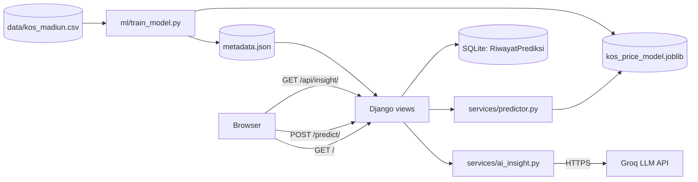

<div align="center">

# GusSearch Kost

**Prediksi Kost by Ai — perkiraan harga sewa kost di Kota Madiun.**

Aplikasi web Django yang memperkirakan harga sewa bulanan dengan machine learning, lalu memberikan penjelasan sederhana dengan bantuan AI (Groq).


[English](README.md) · [Bahasa Indonesia](README.id.md)

</div>

---

## Daftar Isi

- [Gambaran Umum](#gambaran-umum)
- [Fitur](#fitur)
- [Arsitektur](#arsitektur)
- [Teknologi](#teknologi)
- [Struktur Projek](#struktur-projek)
- [Memulai](#memulai)
- [Konfigurasi](#konfigurasi)
- [Cara Penggunaan](#cara-penggunaan)
- [Pipeline Machine Learning](#pipeline-machine-learning)
- [Referensi API](#referensi-api)
- [Performa Model & Keterbatasan](#performa-model--keterbatasan)
- [Catatan Keamanan](#catatan-keamanan)
- [Roadmap](#roadmap)
- [Kontribusi](#kontribusi)
- [Lisensi](#lisensi)

## Gambaran Umum

Calon penyewa sering tidak tahu apakah harga kost yang ditawarkan wajar. **GusSearch Kost** menerima tiga masukan sederhana dan mengembalikan perkiraan harga sewa per bulan beserta kisaran wajarnya:

| Masukan | Keterangan |
|---|---|
| Jarak | Jarak ke pusat kota (km) |
| AC | Apakah kamar ber-AC (`ya` / `tidak`) |
| Rating | Nilai ulasan penghuni (0–5) |

Selain angka prediksi, AI melalui [Groq](https://groq.com) memberikan penjelasan singkat untuk ringkasan pasar, hasil prediksi, grafik, dan tingkat keandalan model. Penjelasan tersebut dapat keliru, jadi periksa kembali data aslinya.

<!-- Tambahkan tangkapan layar ke docs/screenshots/ lalu aktifkan:

-->

## Fitur

- **Prediksi harga**: perkiraan sewa bulanan, kisaran wajar, dan perbandingan dengan rata-rata pasar.
- **Dasbor pasar**: statistik utama (jumlah, rata-rata, median, termurah, termahal, rating rata-rata).
- **Grafik interaktif**: harga AC vs non-AC, harga vs jarak, dan harga vs rating (nama kos tampil saat kursor diarahkan).
- **Penjelasan AI**: insight per bagian dengan cache di server dan tombol *Jelaskan ulang*.
- **Riwayat prediksi**: 15 prediksi terbaru tersimpan dan ditampilkan, dengan opsi untuk menghapus seluruh riwayat.
- **Kartu model yang transparan**: MAE, R², dan jumlah data latih/uji ditampilkan beserta kamus istilah.
- **Responsif**: nyaman di desktop maupun ponsel, menghormati pengaturan *reduced motion*.

## Arsitektur



## Teknologi

| Lapisan | Teknologi |
|---|---|
| Backend | Django (Python) |
| Machine learning | scikit-learn, joblib |
| Penjelasan LLM | Groq API |
| Database | SQLite |
| Frontend | Template Django, Tailwind CSS (CDN), Chart.js |

## Struktur Projek

```
KOS-PREDICT-AI/
├── manage.py                    # Titik masuk Django
├── .env                         # Rahasia: API key Groq & model (jangan di-commit)
├── db.sqlite3                   # Database lokal (riwayat prediksi)
│
├── config/                      # Konfigurasi utama Django
│   ├── settings.py
│   └── urls.py
│
├── data/
│   └── kos_madiun.csv           # Dataset: nama, jarak, harga, AC, rating
│
├── ml/
│   └── train_model.py           # Melatih & membandingkan model kandidat
├── ml_models/
│   ├── kos_price_model.joblib   # Model hasil training (dipakai prediksi)
│   └── metadata.json            # Metrik evaluasi (MAE, R², ukuran split)
│
└── prediction/                  # Aplikasi utama
    ├── models.py                # RiwayatPrediksi (riwayat prediksi)
    ├── views.py                 # Halaman, form prediksi, API insight
    ├── urls.py                  # /, /predict/, /api/insight/
    ├── services/
    │   ├── predictor.py         # Memuat model & menghitung prediksi
    │   └── ai_insight.py        # Klien Groq untuk penjelasan berbantuan AI
    └── templates/prediction/
        ├── dashboard.html       # Tampilan utama (5 tab)
        └── _ai_card.html        # Komponen kartu penjelasan berbantuan AI
```

## Memulai

### Prasyarat

- Python 3.10 atau lebih baru
- [API key Groq](https://console.groq.com/keys) (gratis)

### Instalasi

```bash
# 1. Clone repositori lalu masuk ke foldernya
git clone <url-repositori-anda> KOS-PREDICT-AI
cd KOS-PREDICT-AI

# 2. Buat dan aktifkan virtual environment
python -m venv .venv
source .venv/bin/activate            # Windows: .venv\Scripts\activate

# 3. Pasang dependensi
pip install -r requirements.txt

# 4. Atur variabel lingkungan (lihat Konfigurasi)
cp .env.example .env                 # lalu edit .env

# 5. Jalankan migrasi database
python manage.py migrate

# 6. Nyalakan server pengembangan
python manage.py runserver
```

Buka **http://127.0.0.1:8000** di browser. Matikan server dengan `Ctrl + C`.

## Konfigurasi

Buat file `.env` di root projek:

```env
GROQ_API_KEY=gsk_xxxxxxxxxxxxxxxx
GROQ_MODEL=openai/gpt-oss-120b
```

| Variabel | Wajib | Keterangan |
|---|---|---|
| `GROQ_API_KEY` | Ya | API key untuk memanggil Groq |
| `GROQ_MODEL` | Ya | Identitas model untuk penjelasan |

Restart server setelah mengubah `.env`.

## Cara Penggunaan

Antarmuka terdiri dari lima tab:

| Tab | Isi |
|---|---|
| **Beranda** | Ringkasan pasar Madiun dan ringkasan dari AI |
| **Cek Harga Kos** | Form prediksi, perkiraan sewa, kisaran wajar, penjelasan AI |
| **Grafik Pasar** | Tiga grafik, masing-masing dijelaskan AI |
| **Riwayat** | Daftar prediksi terbaru |
| **Tentang Model** | Akurasi model dengan bahasa sederhana + kamus istilah |

## Pipeline Machine Learning

Latih ulang dan evaluasi model setelah dataset diperbarui:

```bash
python ml/train_model.py
```

Skrip membaca `data/kos_madiun.csv`, membandingkan beberapa model regresi pada data uji, lalu menulis:

- `ml_models/kos_price_model.joblib`: model yang dipakai untuk prediksi
- `ml_models/metadata.json`: metrik yang tampil di tab **Tentang Model**

Fitur: `jarak_km`, `ac`, `rating`. Target: harga sewa bulanan (Rupiah).

## Referensi API

### `GET /api/insight/`

Mengembalikan penjelasan hasil AI untuk satu bagian dasbor.

| Parameter query | Nilai | Keterangan |
|---|---|---|
| `topik` | `ringkasan`, `prediksi`, `grafik_ac`, `grafik_jarak`, `grafik_rating`, `model` | Bagian yang dijelaskan |
| `refresh` | `1` (opsional) | Lewati cache dan buat ulang |

**Respons sukses**

```json
{
  "ok": true,
  "text": "…",
  "model": "openai/gpt-oss-120b",
  "generated_at": "…",
  "cached": true
}
```

**Respons gagal**

```json
{ "ok": false, "error": "…" }
```

### `POST /predict/`

Kirim form (dilindungi CSRF) berisi `jarak_km`, `ac` (`ya` | `tidak`), dan `rating`. Hasil disimpan ke riwayat lalu dasbor ditampilkan.

## Performa Model & Keterbatasan

- Dataset **kecil (30 kos)**, sehingga metrik bervariasi tinggi dan prediksi bersifat indikatif, bukan acuan mutlak.
- Hanya tiga fitur yang dipakai; harga sebenarnya juga dipengaruhi fasilitas, luas kamar, lokasi, dan kebijakan pemilik.
- MAE dan R² terkini selalu tampil di tab **Tentang Model**; R² mendekati atau di bawah 0 berarti model masih lemah.
- Penjelasan LLM dibuat dari angka di dasbor dan **bisa keliru**. Selalu cek dengan data aslinya.
- Aplikasi ini membantu pengambilan keputusan, bukan pengganti survei langsung dan tawar-menawar dengan pemilik kos.

## Catatan Keamanan

- Jangan pernah meng-commit `.env` atau API key. Tambahkan `.env` dan `db.sqlite3` ke `.gitignore`.
- Atur `DEBUG = False`, `SECRET_KEY` yang kuat, dan `ALLOWED_HOSTS` sebelum deployment publik.
- Ganti (rotate) API key Groq segera jika pernah terekspos.

## Roadmap

- [ ] Perluas dataset (lebih banyak kos, fasilitas, luas kamar, kawasan)
- [ ] Tambah interval prediksi berdasarkan ketidakpastian model
- [ ] Unit test untuk predictor dan layanan insight
- [ ] Setup Docker dan pipeline CI
- [ ] Ekspor riwayat prediksi (CSV)

## Kontribusi

Kontribusi sangat disambut.

1. Fork repositori dan buat branch fitur: `git checkout -b feat/fitur-saya`
2. Commit dengan pesan yang jelas: `git commit -m "feat: tambah fitur saya"`
3. Push lalu buka Pull Request yang menjelaskan perubahan dan cara mengujinya

## Lisensi

Lisensi belum ditentukan. Tambahkan file `LICENSE` (misalnya MIT) sebelum projek didistribusikan.
